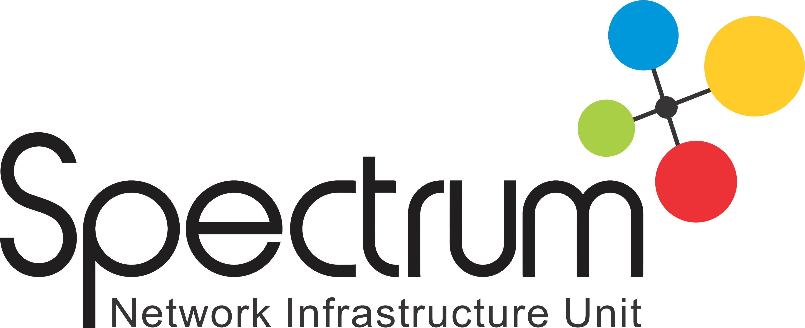

  

# PT Spectrum Indowibawa

PT Spectrum Indowibawa (spectrumindo.com) is a distributor of networking and telecommunications equipment in Indonesia. Its products include access points, wireless routers, switches, antennas, and server racks, for both indoor and outdoor use. The company is part of the PT Dutakom Wibawa Putra (DNET) group.

Besides selling hardware, Spectrum provides system integration for enterprise and ISP customers, after-sales services (maintenance, warranty, and RMA), and network training, including MikroTik certification.

It has offices in two cities:

- **Surabaya:** Ciputra World Office Tower 30th Floor, Jl. Mayjen Sungkono No. 89

- **Jakarta:** Ruko Harco Elektronik Mangga Dua H-6, Jl. Mangga Dua Raya, Central Jakarta
